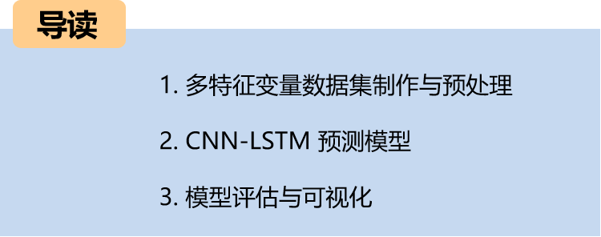
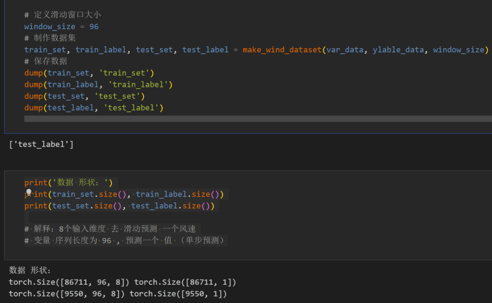
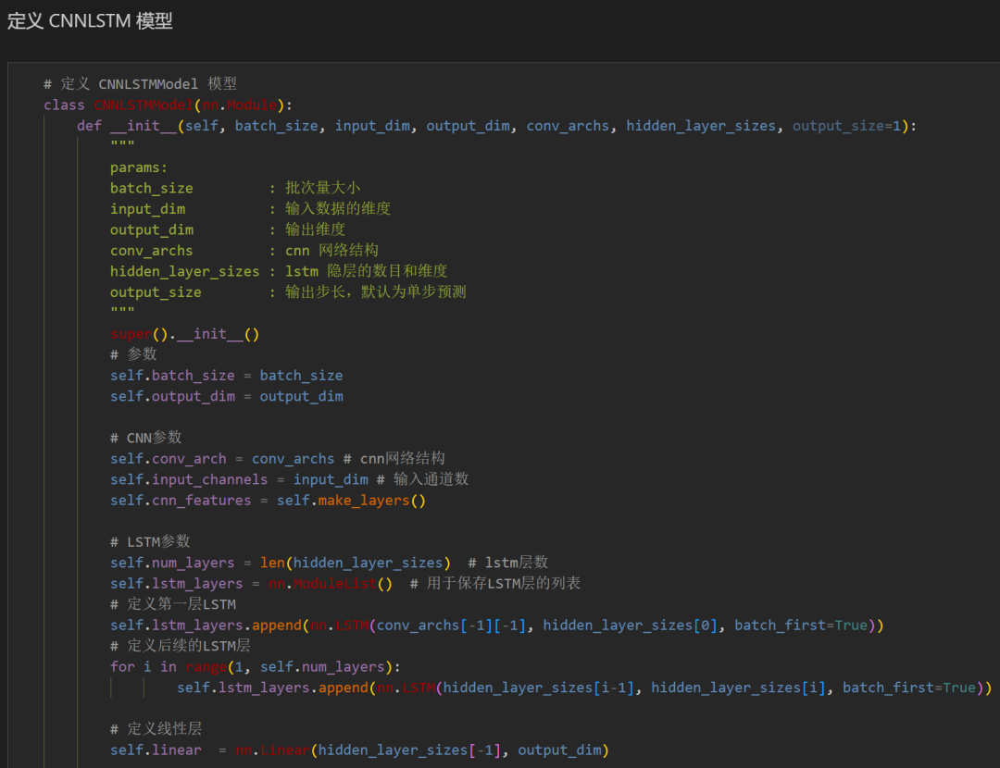
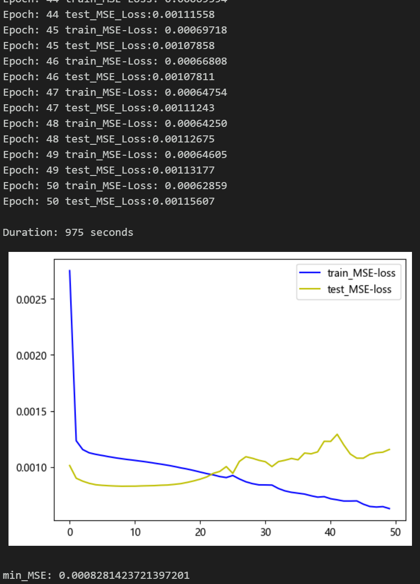
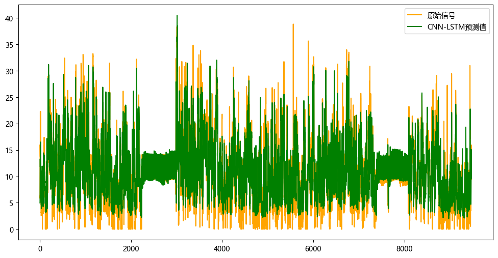
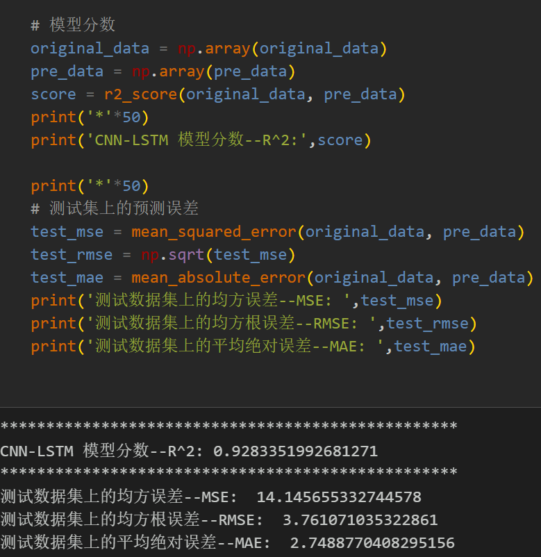

# Multi-feature Variable Sequence Prediction (I) CNN-LSTM Wind Speed Prediction Model

1. Multi-feature Variable Data Set Production and Preprocessing

The following content includes:
- Wind speed data, as well as pre-generated datasets and label sets for wind speed, all of which can be run successfully.
- CNN-LSTM model, with smaller MSE and MAE, showing significant performance improvements.
- Code for data preprocessing, as well as complete CNN-LSTM model prediction code and visualization code.
Environment: Python 3.9
Preface
This article introduces a multi-feature variable sequence prediction model CNN-LSTM based on the previously introduced wind speed data (attached to the end of this document as dataset). The aim is to enhance the predictive performance of time series data. The dataset consists of nine variables including weather, temperature, humidity, pressure, and wind speed, created through sliding windows. It uses multiple variables to predict wind speed.

LSTF (Long Sequence Time-Series Forecasting) issues refer to the need to handle long sequences in time series forecasting. In practical applications, time series may contain a very large number of data points. In such cases, traditional time series forecasting models might encounter challenges due to issues associated with handling long sequences, such as:
- Long-term dependency: As the time series data grows, the model needs to be able to capture long-term dependencies and trends.
- Computational complexity: Training and predicting for long sequences typically require more computational resources and time.
- Memory consumption: Long sequences often require a large amount of memory to store data and model parameters, which could lead to memory exhaustion or performance degradation issues.
When dealing with LSTF issues, selecting an appropriate window size (window size) is crucial. Selecting the right window size can help the model better capture patterns and features within the time series, and to extract longer dependencies for modeling. This paper increases the window size to 96 and employs the CNN-LSTM model to fully extract feature information from the sequence.
1.1 Import data
1.2 Dataset Preparation and Preprocessing
\tFirst, divide the dataset into training set and test set according to a ratio of 9:1.
\t  
\t  
\t\tCreating a dataset
2. CNN-LSTM Prediction Model Based on Pytorch
2.1 Define the CNN-LSTM prediction model
\tNote: The input wind speed data has a shape of [256, 96, 8], where batch_size=256. The 96 represents the sequence length (the values are taken from a sliding window), and the 8 dimensions represent the 8 variables selected.
\t  
2.2 Set parameters and train the model
\t50 epochs, MSE is 0.00082814, the prediction effect of multi-variable feature CNN-LSTM is good, appropriately adjusting model parameters can further improve the model prediction performance.
\tNote: Adjust parameters.
\tIt is appropriate to increase the number of CNN layers and the dimensionality of hidden layers, and fine-tune the learning rate.
Adjust the number of LSTM layers and dimensions, increase more epochs (note to prevent overfitting).
\tThe sliding window length can be changed (set the appropriate window length).
3. Model Evaluation and Visualization
3.1 Results Visualization
3.2 Model Evaluation

## Images

<!-- PAYMENT_BLOCK -->

## Get this dataset

- Payment link (Stripe): [Buy now](https://buy.stripe.com/3cs8yP7sY87d0vu9AB)
- Payment QR code: 

<!-- /PAYMENT_BLOCK -->
